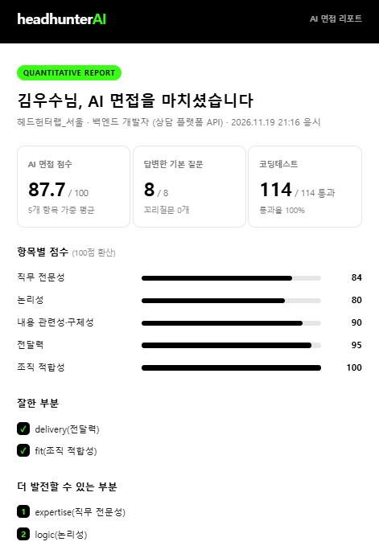
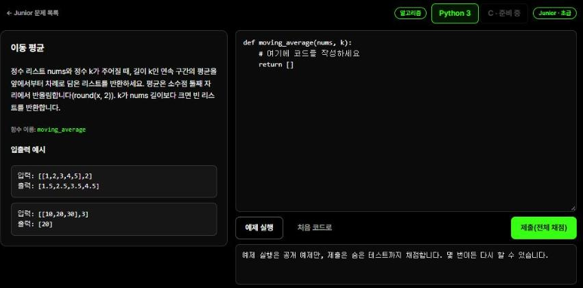
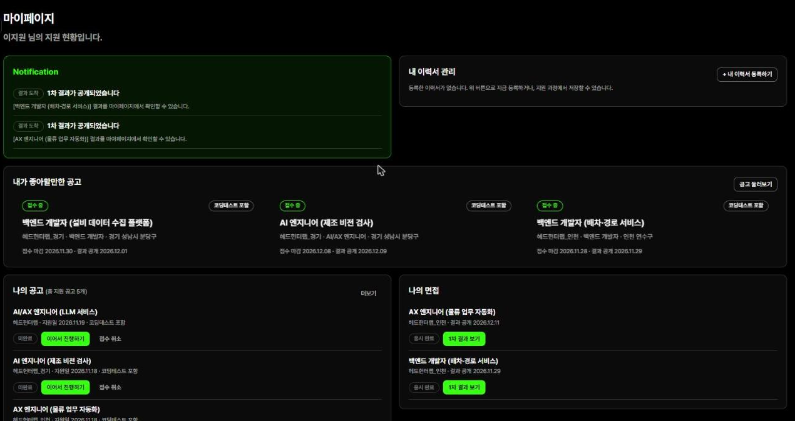
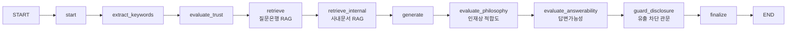
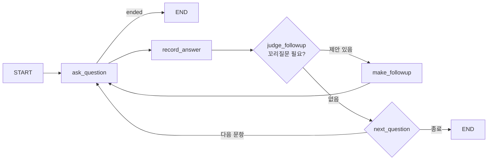
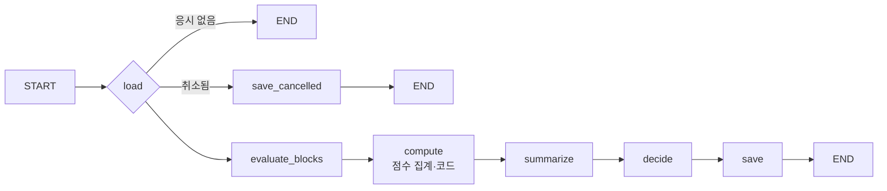

<p align="center">
  
</p>

<h1 align="center">headhunterAI</h1>

<p align="center">
  <b>사내문서를 근거로 면접 질문을 생성하고, 음성 면접을 진행하고, 평가 리포트까지 만드는 AI 면접 시스템</b><br>
  <sub>LangGraph 멀티에이전트 · 자체 호스팅 LLM · RAG · 정보유출 차단 관문</sub>
</p>

<p align="center">
  
  
  
  
  
  
  
  
</p>

> **English summary** — An AI interview platform that grounds every generated question in the hiring
> company's own internal documents, runs a voice interview with LLM-judged follow-up questions, and
> produces a scored evaluation report. Built as a LangGraph multi-agent system on a self-hosted LLM
> (Ollama), with a two-layer disclosure guard that keeps confidential internal facts from leaking into
> questions shown to candidates. ~10k LOC of Python across 29 agent modules and 3 compiled graphs.

---

## 무엇을 해결하는가

채용 면접 질문은 보통 둘 중 하나다. 직무 일반론("REST API란 무엇인가")이거나, 면접관이 즉석에서
떠올린 질문이다. 전자는 지원자를 변별하지 못하고, 후자는 면접관마다 기준이 달라진다.

headhunterAI는 **그 회사의 사내문서**(직무기술서·프로젝트 기록·장애 회고·기술 카드·인재상)를 근거로
질문을 만든다. 그래서 "콜센터 AI 상담 프로젝트에서 RAG 검색 품질이 떨어졌을 때 어떤 순서로 원인을
좁히겠는가" 같은, **그 조직에서만 나올 수 있는 질문**이 생성된다.

여기서 핵심 난점이 생긴다 — 사내문서에는 고객사 실명, 계약 금액, 장애 상세, 미공개 일정이 들어 있다.
질문은 지원자에게 보여지므로, **근거로는 쓰되 내용은 새지 않아야 한다.** 이 프로젝트에서 가장 많은
설계 비중이 들어간 부분이 이 문제다.

## 데모

| 지원자 리포트 | 코딩 테스트 | 관리자 대시보드 |
|---|---|---|
|  |  |  |

## 아키텍처

LangGraph로 컴파일된 그래프 **3개**가 서로 다른 수명주기를 담당한다.

### 그래프 1 — 질문 생성 (`agents/question_graph.py`)



이력서 OCR 결과에서 키워드를 뽑고(`extract_keywords`), **모델이 뽑은 키워드를 다시 검증한다**
(`evaluate_trust` — 품질 1~5점, 근거 없는 키워드 제거, 최대 1회 재검수). 검증된 키워드로 질문은행과
사내문서를 각각 검색한 뒤 질문을 생성하고, **생성된 질문을 3개의 독립 관문**에 통과시킨다 —
인재상 적합도, 지원자가 실제로 답할 수 있는지, 그리고 사내 기밀이 새지 않았는지.
관문에서 차단된 문항은 백업 층 문항으로 교체해 문항 수를 유지한다.

### 그래프 2 — 면접 루프 (`question_graph.py`, checkpointer 사용)



면접 중 LLM이 답변을 듣고 **꼬리질문을 할지 스스로 판단한다**(`judge_followup`).
`thread_id = attempt_id`로 checkpointer에 상태를 보관해 연결이 끊겨도 면접을 이어받고,
checkpoint가 깨지면 DB에서 상태를 재구성한다.

### 그래프 3 — 평가 (`agents/evaluation_graph.py`)



**점수·합불 판정은 LLM이 하지 않는다.** `compute`/`decide`는 코드 전용 경로다 — LLM은 블록별
정성 평가와 요약만 담당하고, 숫자와 최종 판정은 결정적(deterministic) 로직이 맡는다.
그래프 상태(`agents/state.py`)에 점수·합불·응시 상태 필드를 아예 두지 않아 이 경계를 구조로 강제했다.

## 핵심 설계 결정

이 레포에서 봐주시면 좋은 부분들입니다. 각 결정의 근거는 해당 파일 상단 docstring에 남겨 뒀습니다.

### 1. 정보유출 차단을 2층으로 나눴다 — 마스킹 + 관문

**`agents/internal_masking.py`** — 사내문서 원본은 `restricted`로 두고, 비공개 문서마다
**마스킹한 사본**(`doc_id = MSK-*`, `disclosure = public`)을 따로 만들어 문서 목록에 더한다.
그러면 증분 동기화·라우팅·정리·감사 로직이 사본을 특별 취급 없이 다룬다. 마스킹은 18개 규칙을
**고정 순서**로 적용한다 — 섹션 제외 → 고객사 가명 → ID 치환 → 문서 참조 → 연락처 삭제 →
금액·비율·공수 수치 → 표 행 삭제 → 표식 밀도 검사. 규칙은 코드가 아니라 `mask_rules.json`에
두어 문서가 늘어도 코드를 고치지 않는다.

**`guard_disclosure` 노드 + `agents/internal_forbid.py`** — 마스킹을 통과해도 **생성된 질문 자체를
한 번 더** 검사한다. 마스킹이 1차 방어(데이터 층), 관문이 2차 방어(출력 층)다. 한 층이 뚫려도
다른 층이 잡는다.

### 2. few-shot 예문이 만드는 4가지 위험을 각각 잡는다

**`agents/fewshot_guard.py`** — 실제 응시 피드백에서 나온 문장들을 질문 생성 지시문의 few-shot
예문으로 넣었더니 품질이 올랐지만, 네 가지 위험이 같이 왔다 — ① 예문 베끼기 ② 예문에만 있는
고유명사가 근거 없이 새어나감 ③ 질문 풀 전체에서 예문 핵심어가 몰림 ④ 예문을 바꾸면 다른 질문
품질이 떨어짐. 이 모듈이 **LLM 호출 0회, 규칙·지표만으로** ①②를 잡고, 감사 도구가 ③④를 본다.
예문을 바꾸면 등록부에 올려야 하고, 테스트가 등록부와 실제 지시문의 불일치를 깨뜨린다.

### 3. LLM 실패가 기능 중단이 되지 않게 했다

**`app/llm.py`** — 프로바이더를 교체하려면 `LLM_MODEL` / `LLM_BASE_URL`만 바꾼다. 그리고
**모든 호출자는 `LLMError`를 받아 규칙 기반 대체 경로로 떨어진다** — 질문 생성은 `gen_method`에
`db | llm | template | fallback_job` 네 등급을 기록해, 어느 문항이 어떤 경로로 만들어졌는지
사후에 추적된다.

### 4. 프롬프트를 코드에서 분리했다

**`app/prompts/`** (33개 `.md`) — 생성 프롬프트와 평가 프롬프트를 `generate/` · `evaluate/` 로
나눠 마크다운으로 둔다. 프롬프트 수정이 Python diff에 섞이지 않고, 평가 프롬프트
(`judge_question_quality.md`, `judge_report_quality.md`)는 LLM-as-judge 평가 파이프라인이
그대로 읽어 쓴다.

### 5. 자체 호스팅 LLM을 기본값으로 잡았다

지원자 이력서와 사내문서를 다루므로 외부 API로 데이터가 나가지 않도록 **Ollama 자체 호스팅**이
기본 경로다. LangSmith 추적은 `DEV_MODE=1` + 키가 모두 있을 때만 켜지고, 실제 지원자 데이터로는
켜지 않는다. GPU 환경은 `docker-compose.gpu.yml`로 분리했다.

## 품질을 어떻게 측정했는가

LLM 시스템은 "돌아간다"와 "쓸 만하다"가 다르다. 이 프로젝트는 질문 생성과 리포트 품질에
**번호가 붙은 지표 M-31~M-44**를 정의하고, 실행마다 측정해 기준선과 비교했다.
정의는 [`docs/qa/eval_qa.md`](docs/qa/eval_qa.md), 측정 스크립트는 `backend/tools/eval_*.py` 14개다.

통과 기준을 세 겹으로 뒀다.

1. **하드 제약** — 대외비 누출(M-36)·인용 정확성(M-38)·금지 내용(M-41)은 **위반 0건**. 1건이라도 나오면 실패.
2. **평균 + 신뢰구간 하한** — 루브릭 지표는 평균 ≥4.0 **그리고** 95% CI 하한 ≥3.7. 평균만 보면 분산이 큰 모델이 통과해 버린다.
3. **회귀 허용 폭** — 기준선 대비 −0.2점 / −5%p보다 나빠지면 실패.

평균의 신뢰구간은 부트스트랩(B=5000), 비율은 Wilson 구간으로 구했다. 판정 모델(LLM-as-judge)은
외부 API를 쓰지 않고 로컬 Ollama(`qwen3:8b`)로 돌리며, 6GB GPU에서 `qwen3:4b`로 대체할 때는
**자기 평가 편향 가능성을 결과에 명시**한다.

지표 예시 (전체는 `eval_qa.md`):

| ID | 대상 | 지표 | 측정 | 목표 |
|---|---|---|---|---|
| M-32 | 질문 생성 | 근거 있는 질문 비율 | 코드 + 판정 | ≥0.95 |
| M-33 | 질문 생성 | 루브릭 평균(명확성·관련성·답변가능성·비편향) | 판정 모델 1~5 | ≥4.0, CI 하한 ≥3.7 |
| M-34 | 질문 세트 | 의미 중복 쌍 비율(임베딩 코사인 ≥0.85) | 코드 | ≤0.05 |
| M-35 | 출제 경로 | 대체 경로(Redis 실패·문항 부족) 비율 | 코드 | ≤0.20 |
| M-36 | 사내문서 | **대외비 누출** | 코드 | **0건 (하드)** |
| M-37 | 질문 세트 | 카테고리 분포 준수율 | 코드 | 1.00 |

검색 전략 비교 실험 결과도 포함했다 — [`docs/qa/eval_runs/mq_rrf_retrieval_2026-11-16.json`](docs/qa/eval_runs/)
은 Multi-Query + RRF(`rrf_k=60`, `mq_n=3`)를 가상 지원자 20명에 대해 측정한 것으로,
판정 호출 373회의 지연(p50 2.2s / p95 4.5s)까지 같이 기록돼 있다.

테스트는 `backend/tools/test_*.py` 9개 — 마스킹, 사내문서 적재, 이중 RAG, 그래프 루프,
질문 규칙, 리포트 메일을 각각 검증한다.

## 스택

| 영역 | 선택 |
|---|---|
| 오케스트레이션 | LangGraph 1.2 (컴파일 그래프 3개, checkpointer) |
| LLM | Ollama 자체 호스팅 (OpenAI 호환 경로 병행) |
| 검색 | Chroma (사내문서·질문 벡터) + Redis 8 Query Engine |
| API | FastAPI 0.115 + psycopg 3 (connection pool) |
| 저장소 | PostgreSQL 16 |
| 문서 처리 | PyMuPDF + pytesseract (이력서 OCR) |
| 음성 | 별도 `speech` 서비스 컨테이너 (STT) |
| 코드 실행 | 샌드박스 `runner` 컨테이너 (코딩 테스트 채점) |
| 관측 | LangSmith `@traceable` (개발 환경 한정) |
| 인증 | argon2 |

## 실행

Ollama가 호스트에 떠 있어야 한다. 비밀 값은 `.env`에 두며 커밋되지 않는다.

```bash
ollama pull <LLM_MODEL>

# .env 작성 — LLM_BASE_URL / LLM_MODEL / EMBED_MODEL
#   LLM_BASE_URL=http://host.docker.internal:11434

docker compose up -d --build
# GPU: docker compose -f docker-compose.yml -f docker-compose.gpu.yml up -d --build
```

사내문서 RAG 적재와 사내문서 기반 질문 생성은 별도 단계다.

```bash
docker exec headhunterAI-api python -m app.agents.internal_docs_agent ingest        # 약 8분
docker exec headhunterAI-api python -m app.agents.internal_question_agent generate  # 약 30분
```

화면·API 모두 FastAPI가 서빙한다 — 메인 `http://localhost:8000/` · API 문서 `http://localhost:8000/docs`

이력서 업로드 데모는 `dummies_resume/_src/`의 가상 이력서를 PDF로 빌드해 쓴다
(`tools/build_pdf.py`).

## 디렉토리

```text
backend/app/
├── agents/            # LangGraph 노드·에이전트 29개 (9,000 LOC)
│   ├── question_graph.py           # 그래프 1·2: 질문 생성 + 면접 루프
│   ├── evaluation_graph.py         # 그래프 3: 평가·합불
│   ├── job_posting_graph.py        # 공고 RAG 적재·재생성
│   ├── internal_docs_agent.py      # 사내문서 적재·청킹·증분 동기화
│   ├── internal_question_agent.py  # 사내문서 근거 질문 생성
│   ├── internal_masking.py         # 공개용 사본 마스킹 18규칙
│   ├── internal_forbid.py          # 금칙 검사
│   ├── fewshot_guard.py            # few-shot 위험 4종 차단
│   ├── coding_*.py                 # 코딩 문제 생성·검증·품질 (5개)
│   ├── sql_*.py                    # SQL 문제 생성·범위 제한
│   ├── followup_agent.py           # 꼬리질문 판단
│   ├── translation_agent.py        # 다국어
│   ├── rag_fusion.py               # 검색 결과 융합
│   └── state.py                    # 그래프 간 상태 계약
├── prompts/           # 생성·평가 프롬프트 33개 (.md)
├── llm.py             # 프로바이더 추상화 + 폴백
├── vectorstore.py     # Chroma·Redis 검색 계층
└── routes_*.py        # FastAPI 라우터 (지원자·관리자·인증·결제)

backend/tools/         # 테스트 9개 (test_*.py) + 품질 측정 14개 (eval_*.py)
backend/db/            # schema.sql + 질문은행·코딩문제 시드

docs/qa/               # AI 품질 지표 정의(M-31~M-44) + 측정 결과
internal_documents/      # 사내문서 RAG 코퍼스 — 전부 가상 ('헤드헌터랩')
questionbank/            # 질문은행 시드 + 직무별 질문 7종
dummies_resume/_src/     # 가상 이력서 원본 (실존 인물 정보 없음)
tools/                   # LLM 품질 QA 에이전트·평가 계획
main/ applicant/ admin/  # 프론트엔드 (메인·지원자·관리자)
legal/                   # 개인정보처리방침·이용약관·개인정보 영향평가
```

## 이 레포의 범위

원본 저장소(227MB, 81 커밋)에서 **코드와 실행에 필요한 것만** 추린 공개용 저장소입니다.
제외한 것과 그 이유:

- **실제 채용공고 스크랩 200건** — 실존 기업 공고와 채용담당자 이메일이 포함돼 개인정보·이용약관
  양쪽에 걸립니다. (`job_posting_resources/README.md`에 상세)
- 설계·기획 문서 191MB (PRD·TRD·ADLC) — 분량 문제이며 기밀은 아닙니다. 다만 AI 품질 지표
  정의와 측정 결과는 코드를 판단하는 데 필요하므로 `docs/qa/`에 추려 넣었습니다.
- 다른 회사 제출 과제물, 팀원 참고 자료.

포함된 사내문서·질문은행·이력서 데이터는 **전부 가상**입니다 — 가상 회사 `헤드헌터랩` 기준으로
작성된 실험용 코퍼스이고, 파일마다 가상임이 표기돼 있습니다. 실존 인물·기업 정보는 없습니다.

## 만든 사람

**김소현 (Sohyun Kim)** · AI/AX Engineer · AI Product Manager

기획(PRD·TRD) 작성부터 그래프 설계·구현·평가 파이프라인까지 단독으로 진행했습니다.
